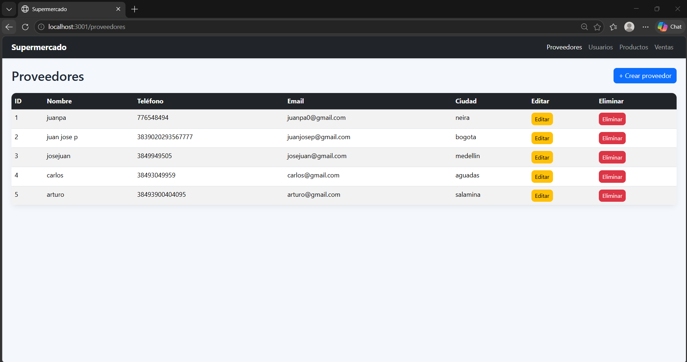
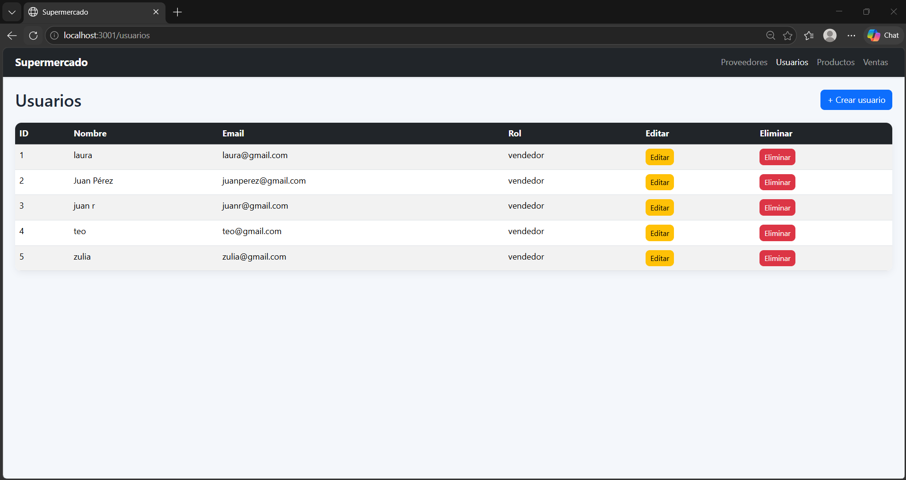
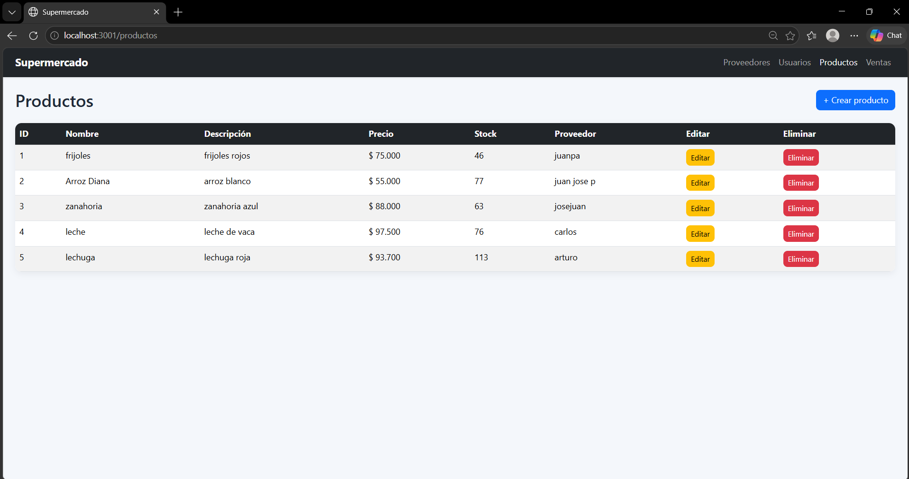
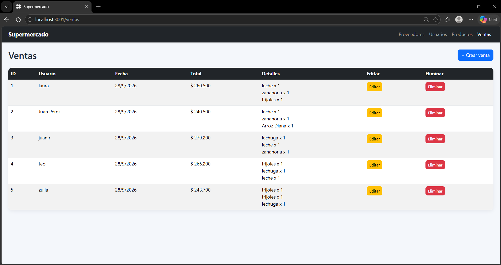

# Actividad Colaborativa II: Taller Integrador – Frontend SPA del Supermercado (React)


---


### Estudiante

Juan Jose Pareja Ruiz


### Universidad

Universidad de Manizales  


### Facultad

Facultad de Ciencias e Ingeniería


### Programa Academico

Programa de Ingeniería de Sistemas Virtual


### Curso

Programacion IV 


### Profesor

Natalia Marcela Castellanos Gomez


---


## Responsabilidades

- La aplicación es una interfaz React para gestionar proveedores, usuarios, productos y ventas.
- La aplicación configura rutas para navegar entre Proveedores, Usuarios, Productos y Ventas.
- La aplicación usa una estructura común de layout con una barra de navegación y un contenedor principal para todas las páginas.
- La app define la ruta raíz para abrir la sección de proveedores.
- La app centraliza las peticiones HTTP en un cliente Axios con base URL localhost:3000.
- La app expone servicios para obtener, crear, actualizar y eliminar proveedores.
- La app expone servicios para obtener, crear, actualizar y eliminar usuarios.
- La app expone servicios para obtener, crear, actualizar y eliminar productos.
- La app expone servicios para obtener, crear, actualizar y eliminar ventas.
- La app expone servicios para crear, actualizar y eliminar detalles de venta.
- La página de proveedores carga la lista de proveedores al abrirse.
- La página de proveedores permite crear proveedores con formulario.
- La página de proveedores permite editar proveedores existentes.
- La página de proveedores permite eliminar proveedores tras confirmación.
- La página de proveedores valida que el nombre no esté vacío; teléfono, correo y ciudad son opcionales y no se valida el formato del correo.
- La página de usuarios carga la lista de usuarios al abrirse.
- La página de usuarios permite crear usuarios con formulario.
- La página de usuarios permite editar usuarios existentes.
- La página de usuarios permite eliminar usuarios tras confirmación.
- La página de usuarios valida que el nombre, correo y rol no estén vacíos.
- La página de usuarios valida el formato del correo antes de guardar.
- La página de productos carga la lista de productos y la lista de proveedores al abrirse.
- La página de productos permite crear productos con formulario.
- La página de productos permite editar productos existentes.
- La página de productos permite eliminar productos tras confirmación.
- La página de productos valida que el nombre no esté vacío.
- La página de productos valida que el precio sea mayor que cero.
- La página de productos valida que el stock no sea negativo.
- La página de productos exige seleccionar un proveedor válido antes de guardar.
- La página de ventas carga la lista de ventas, usuarios y productos al abrirse.
- La página de ventas permite crear ventas con uno o varios detalles.
- La página de ventas permite editar ventas existentes y sus detalles.
- La página de ventas permite eliminar ventas tras confirmación.
- La página de ventas valida que exista un usuario seleccionado.
- La página de ventas valida que cada detalle tenga producto y cantidad válidos.
- La página de ventas permite agregar detalles de venta dinámicamente.
- La página de ventas permite quitar detalles de venta del formulario.
- La app incorpora Bootstrap para estilos y componentes visuales.
- La app aplica estilos propios para el fondo, la barra de navegación, tablas, botones y formularios.


## Instrucciones de ejecución

1. Abrir PowerShell.

2. Ubicarse en la carpeta del proyecto:

```powershell
cd supermercado_frontend
```

3. Instalar los elementos necesarios del proyecto:

```powershell
npm install
```

4. Esperar a que finalice la instalación. En la ejecución proporcionada, termine correctamente.

5. Iniciar el proyecto:

```powershell
npm start
```

6. Si el puerto `3000` ya está ocupado, aceptar la opción para utilizar otro puerto. En la ejecución proporcionada se seleccionó `yes`.

7. Abrir el proyecto en el navegador mediante:

```text
http://localhost:3001
```

8. La ejecución proporcionada confirma que el proyecto inició correctamente y mostró:

```text
Compiled successfully!
```

9. Para detener la ejecución, volver a la ventana donde está funcionando el proyecto y presionar:

```text
Ctrl + C
```


## Descripción de la arquitectura

- El proyecto contiene una aplicación React para gestionar proveedores, usuarios, productos y ventas.
- `index.html` contiene la estructura HTML inicial y el elemento donde se monta la aplicación React.
- `index.js` inicia la aplicación y carga Bootstrap junto con los estilos propios.
- `App.jsx` conecta la aplicación con sus rutas.
- `AppRouter.jsx` define las rutas `/proveedores`, `/usuarios`, `/productos` y `/ventas`. La ruta `/` muestra proveedores.
- `Layout.jsx` coloca la barra superior y el contenido de cada página.
- `Navbar.jsx` muestra enlaces hacia las cuatro secciones.
- `ModalForm.jsx` muestra formularios dentro de una ventana que puede abrirse y cerrarse.
- `axios.js` establece que las peticiones se envían a `http://localhost:3000`.
- `proveedorService.js` permite consultar, crear, modificar y eliminar proveedores.
- `usuarioService.js` permite consultar, crear, modificar y eliminar usuarios.
- `productoService.js` permite consultar, crear, modificar y eliminar productos.
- `ventaService.js` permite consultar, crear, modificar y eliminar ventas.
- `detalleVentaService.js` permite crear, modificar y eliminar detalles de venta.
- `ProveedoresPage.jsx` muestra proveedores, permite crearlos, editarlos y eliminarlos, y valida únicamente que el nombre no esté vacío; teléfono, correo y ciudad son opcionales y el correo no tiene validación de formato.
- `UsuariosPage.jsx` muestra usuarios, permite crearlos, editarlos y eliminarlos, y valida nombre, correo y rol. El único rol disponible en el formulario es `vendedor`.
- `ProductosPage.jsx` muestra productos, carga los proveedores disponibles y permite crear, editar y eliminar productos. Valida nombre, precio, existencias y proveedor.
- `VentasPage.jsx` muestra ventas, carga usuarios y productos, y permite crear, editar y eliminar ventas con uno o varios detalles. También permite agregar o quitar detalles durante la edición.
- Las páginas actualizan nuevamente sus listas después de guardar o eliminar información y muestran mensajes cuando una petición falla.
- `index.css` define el fondo, la barra superior, las tablas, los botones, las ventanas y los formularios.


## Tecnologías utilizadas

- **React 18.3.1:** utilizado para crear las páginas y componentes.
- **React DOM 18.3.1:** utilizado para mostrar la aplicación en el navegador.
- **React Router DOM:** rango declarado `^6.28.0`; versión fijada en `package-lock.json`: `6.30.6`. Utilizado para navegar entre las secciones.
- **Axios:** rango declarado `^1.7.7`; versión fijada en `package-lock.json`: `1.20.0`. Utilizado para enviar peticiones al servidor.
- **Bootstrap:** rango declarado `^5.3.3`; versión fijada en `package-lock.json`: `5.3.8`. Utilizado para los estilos y elementos visuales.
- **JavaScript:** lenguaje utilizado en los archivos `.js`.
- **JSX:** utilizado en los archivos `.jsx`.
- **CSS:** utilizado para los estilos propios en `index.css`.
- **React Scripts 5.0.1:** utilizado para iniciar, compilar y probar la aplicación.
- **npm:** utilizado para instalar las dependencias mediante `npm install` y ejecutar el proyecto mediante `npm start`.
- **Servidor de desarrollo:** se inicia mediante el comando `react-scripts start`, configurado en `package.json`.


## Estructura del proyecto

## Carpetas raiz de la Carpeta `supermercado_frontend`

### Carpeta `node_modules`

- **`node_modules`:** carpeta local con las dependencias instaladas mediante `npm install`.

### Carpeta `public`

- **`index.html`:** contiene la estructura HTML inicial donde se carga la aplicación.


## Carpeta `src`

### Carpeta `api`

- **`axios.js`:** configura las peticiones al servidor usando la dirección `http://localhost:3000`.

### Carpeta `components`

- **`Layout.jsx`:** organiza la barra de navegación y el contenido principal de cada página.
- **`Navbar.jsx`:** muestra la barra de navegación y los enlaces hacia las secciones principales.
- **`ModalForm.jsx`:** muestra formularios dentro de una ventana emergente reutilizable.

### Carpeta `imagenes`

- **`imagenes`:** contiene las capturas de pantalla incluidas como evidencia de funcionamiento.

### Carpeta `pages`

- **`ProveedoresPage.jsx`:** consulta, muestra, crea, modifica y elimina proveedores.
- **`UsuariosPage.jsx`:** consulta, muestra, crea, modifica y elimina usuarios.
- **`ProductosPage.jsx`:** consulta, muestra, crea, modifica y elimina productos. También carga y permite seleccionar un proveedor.
- **`VentasPage.jsx`:** consulta, muestra, crea, modifica y elimina ventas. También permite administrar los productos y las cantidades de cada venta.

### Carpeta `routes`

- **`AppRouter.jsx`:** define las rutas de proveedores, usuarios, productos y ventas. También establece proveedores como la página inicial.

### Carpeta `services`

- **`proveedorService.js`:** envía las peticiones relacionadas con los proveedores.
- **`usuarioService.js`:** envía las peticiones relacionadas con los usuarios.
- **`productoService.js`:** envía las peticiones relacionadas con los productos.
- **`ventaService.js`:** envía las peticiones relacionadas con las ventas.
- **`detalleVentaService.js`:** envía las peticiones para crear, modificar y eliminar detalles de venta.

### Archivos raiz de la Carpeta `src`

- **`App.jsx`:** muestra el componente encargado de organizar las rutas.
- **`index.css`:** contiene los estilos propios del proyecto.
- **`index.js`:** inicia la aplicación React, carga Bootstrap, carga los estilos propios y muestra el componente principal.


### Archivos raiz de la carpeta `supermercado_frontend`

- **`package-lock.json`:** registra las versiones concretas instaladas de las dependencias.
- **`package.json`:** contiene el nombre del proyecto, los comandos disponibles y las dependencias declaradas.
- **`README.md`:** contiene la información y las instrucciones del proyecto.


### Organización general

- **Páginas:** contienen las pantallas principales de la aplicación.
- **Componentes:** contienen elementos reutilizables de la interfaz.
- **Rutas:** definen las direcciones disponibles y la página que se muestra en cada una.
- **Servicios:** centralizan las peticiones que la aplicación envía al servidor.
- **Estilos:** definen la apariencia visual de la aplicación.
- **Archivo de inicio:** pone en funcionamiento la aplicación y muestra el componente principal.


## Evidencia de funcionamiento









